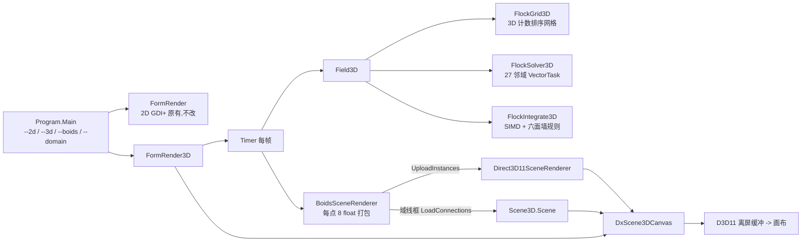

## 用户需求

现有 `Boids.vbproj` 是一个 2D 群集模拟演示：物理算法在 GCModeller 的 `physics\Particles\Boids` 库中，渲染是 GDI+ 手写像素绘制。需要在不破坏原有 2D 版本的前提下，新增一个 3D 版本，并把渲染后端换成 DirectX 三维场景管线。

## 产品概述

同一个可执行程序提供两种运行模式：默认进入三维群集画面，也可通过启动参数回到原来的二维画面。三维画面里成群的个体在一个立方体空间内飞行，可自由环绕观察，个体按飞行速度呈现由深紫到亮黄的渐变配色，少量捕食者以白色高亮；空间边界用细线框勾出，底部铺一层参考网格。窗口标题持续显示物理耗时、渲染耗时与帧率，用于压力测试观察。

## 核心功能

- **三维群集行为**：个体之间保持分离、速度对齐、向邻域中心聚集，并对捕食者产生逃离行为；越靠近边界时被推回，速度被限制在最小/最大区间内，速度为单位距离每步。
- **大规模实时模拟**：默认 12 万个个体同屏运动，物理求解与绘制互不阻塞界面，帧率与耗时指标实时可见。
- **三维自由视角**：鼠标左键拖拽环绕旋转、右键拖拽平移、滚轮推近拉远；另有重置视角、自动适配模型、切换地面网格、切换调试信息、导出当前画面等键盘快捷键。
- **空间参照物**：模拟空间的立方体边界线框与地面网格，让观察者能感知个体在空间中的前后远近与聚集位置。
- **速度配色与捕食者高亮**：普通个体按速度取渐变色谱，捕食者固定为白色并略大一点，与二维版本配色保持一致。
- **双模式共存**：启动参数选择二维或三维，默认三维；二维画面保持原有外观与操作方式完全不变，两者互不影响。
- **参数可调**：个体数量、模拟空间边长、个体在屏幕上的点尺寸可通过启动参数调整；提供自检模式输出版本化的模拟正确性校验结果。

## 技术栈

- 语言/运行时：VB.NET，`net10.0-windows`（Boids 应用）、`net10.0`（Particles 库，已有 SDK 通配符编译，新增 `.vb` 自动纳入）
- 三维渲染：`DXApi`（`Direct3D11SceneRenderer`）+ `DxCanvas`（`DxScene3DCanvas`），**Boids.vbproj 已引用这两个工程，无需改引用**
- 并行/数学：`Microsoft.VisualBasic.Parallel.VectorTask`、`System.Numerics.Vector(Of Double)`（经 `SIMDEnvironment` 开关）、`BoidMath.Round`
- 配色：`Microsoft.VisualBasic.Imaging.Drawing2D.Colors.Designer.GetColors(ScalerPalette.viridis.Description, 30)`

## 实现方案

核心判断：3D 版不能把动画点云交给 `Scene.LoadPointCloud`。`Scene` 每次装载都会 `Version += 1`，导致 `Direct3D11SceneRenderer` 的 `GpuSceneGeometry` 全量重建（面/线/实例缓冲全部重新创建），对 12 万点逐帧重建不可接受；且 `LoadPointCloud` 会把几何按质心平移并连带平移线框。

渲染走 `Direct3D11SceneRenderer` 专为动画点云预留的**外部实例缓冲**：

- `EnsureInstanceCapacity(count)` 一次性预留；
- 每帧 `UploadInstances(buf, count)` 只重填一个 32 字节/点的缓冲（12 万点 ≈ 3.84 MB/帧），`UpdateSubresource` 上传，不触碰 `Scene.Version`，GPU 侧一次 `DrawInstanced(6, count)`；
- 场景本身只放**域线框**（12 条 `LineSegment`，一次性 `LoadConnections`）。这同时解决两个硬约束：(1) `DxScene3DCanvas` 内部只在 `Scene.HasData` 为真时才调用后端，无几何则不画任何东西；(2) 线框决定 `Scene.Radius` 与 `GroundZ`，使 `FitView` 能把整个立方体框进视野、地面网格落在域底。

颜色走**嵌入色直通**路径：`UseEmbeddedColor = True` 时像素着色器 `PS_Point` 在 `color.a > 0` 时直接返回实例颜色、完全不查调色板纹理，因此"普通个体按速度取 viridis + 捕食者纯白"可以在同一批实例里实现（调色板模式无法给单个点指定异色）。同一模式下 `heat` 槽被用作每点尺寸因子，捕食者可顺带放大。

物理侧按二维实现**逐行对称移植**（常量、累加顺序、两阶段语义完全一致），只是把 2 维换成 3 维、9 邻域换成 27 邻域、2 面墙换成 6 面墙。

### 性能与规模

- 邻域候选数决定开销：二维 15 px 单元 × 3×3 窗口 = 45×45 = 2025 px²，密度 12 万/(2000×1200) ⇒ 每帧每只约 101 个候选。三维取 27×15³ = 91 125 单位³，目标密度 ≈ 1.1e-3/单位³（同样约 101 候选）⇒ 12 万只对应域边长 ≈ 476，取 **480**。
- 因此三维单只开销≈二维（只多一次乘加求距离），而不是直觉上的 3 倍；瓶颈仍在并行求解，绘制侧恒定一次实例化 draw call。
- 每帧 CPU 预算：求解数十毫秒（24 线程）；打包 12 万点（sqrt + LUT + 4 字节写）1–2 ms；上传 3.84 MB 约 1–2 ms。均可用 `PerformanceCounter` 分段计时。
- `MultisampleCount` 保持 1（屏幕对齐方块几乎无抗锯齿收益，省掉 MSAA resolve）。

### 复杂度

- `FlockGrid3D.Build`：O(N)，计数排序（count → prefix sum → fill），与二维同构。
- `FlockSolver3D`：O(N·27·avgCell)，与 `VectorTask` 分片并行；分片按 `sortedIds` 的 cell 顺序切，保持缓存局部性与累加顺序确定性。
- `FlockIntegrate3D`：O(N)，SIMD 4 lane + 标量尾。

## 架构设计



分层：`Program`（入口/参数）→ `FormRender3D`（UI 与帧调度）→ `BoidsSceneRenderer`（三维表示与上传）→ `Field3D`（模拟）。库侧保持 `Field3D → FlockGrid3D / FlockSolver3D / FlockIntegrate3D`，与二维一一对应，二维文件零改动。

## 实现要点

### 库侧（`G:\GCModeller\src\runtime\sciBASIC#\physics\Particles\Boids\`，命名空间 `Microsoft.VisualBasic.Engine.Particles.Boids`）

- `FlockState3D`：9 个只读数组 `px,py,pz,vx,vy,vz,dvx,dvy,dvz` + `count` + `Clone()`，与 `FlockState` 同构。
- `FlockGrid3D`：`cellStart/sortedIds/cellOfX/cellOfY/cellOfZ`、`nx,ny,nz,minCx,minCy,minCz,nCells`；`CellId = (cz-minCz)*(nx*ny) + (cy-minCy)*nx + (cx-minCx)`；包围盒 ±1 格 padding；非有限坐标钉到最小角落。
**新增健壮性**（二维没有、三维必须加）：坐标 `|v/cellSize| >= 2^50` 视为坏值（`BoidMath.Round` 的魔法数只对 `|v|<2^51` 有效，否则单元号越界直接 IndexOutOfRange）；`nCells` 先按 `Long` 计算，若超过 `Integer.MaxValue` 则按 1.5 倍放大 `cellSize` 重算（自适应降级而非崩溃）。
- `FlockSolver3D`：`Inherits VectorTask`，常量与二维完全相同（`flockDistance=50 / avoidDistance=20 / predatorDistance=150 / cohesionPower=0.0003 / alignPower=0.01 / avoidPower=0.001 / predatorPower=0.00005`），`dz/dy/dx = -1..1` 三层循环 + `Continue For` 越界跳过；`dvx = 聚集 + 分离 + 对齐 + 捕食者*predatorPower`。
- `FlockIntegrate3D`：`SIMDEnvironment.IsEnabled AndAlso Vector.IsHardwareAccelerated` 走 4-lane，否则标量；语义严格为 `v += dv` → `p += v` → 速度夹紧 `[1, MaxSpeed]` → NaN 归零 → 六面 `bouncePad=50/bounceTurn=0.5` 转向 → 三轴 wrap。
- `Field3D`：`Width/Height/Depth`、`MaxSpeed=6`、`PredatorCount=6`、`State`、`Friend Grid`、`Friend Radius=15`、`New(w,h,d,Optional count=100)`（`randf.seeds` 随机初值，构建设置 `VectorTask.n_threads`）、`Advance(Optional bounceOffWalls=True, Optional wrapAroundEdges=False)`。
- `Boid3D`：值视图（x/y/z/Xvel/Yvel/Zvel/GetSpeed），供 `Field3D.Item(i)` 使用。
- 注意 `GenerateDocumentationFile=True`：所有 `Public` 成员必须写 XML 注释；`Module` 成员不能 `Shared`；`Imports std = System.Math` 避免裸 `Math`。

### 应用侧（`g:\Microsoft.VisualBasic.Drawing\src\Boids\`）

- `BoidsSceneRenderer`（`Rendering/`）：唯一接触 DirectX 的类。职责（1）构建域线框 12 条边（颜色如 `Color.FromArgb(90,90,110)`），`canvas.LoadConnections(...)` 一次性完成并借 `ApplyNewScene` 顺带 `Reset`+`FitView`；（2）`Configure(canvas)`：`BackgroundColor=Black`、`UseEmbeddedColor=True`、`PointSize`、`PointAlpha=255`、`ShowGround=True`、`ShowConnections=True`、`EnableKeyboardShortcuts=True`、`Renderer` 保持默认 `Direct3D11SceneRenderer`；（3）`Reset(count)` 调 `EnsureInstanceCapacity`；（4）`Pack(field)` 每帧填充实例数组；（5）`Upload()` 调 `UploadInstances`。
- `FormRender3D`：`Reset()`（`VectorTask.n_threads = App.CPUCoreNumbers`、算域边长、`New Field3D`、`renderer.Reset(count)`、预热 5 帧避免首帧 JIT 计入计时）、`timer.Tick`（`counter.Set()` → `Advance()` → `Mark("physics")` → `Pack` → `Mark("pack")` → `Upload()` → `canvas.RequestRender()` → `Mark("present")`）、标题文本节流到约 5 Hz（二维是每帧写 `Text`，三维逐帧刷标题会吃掉帧时间）、`SnapshotRequested` 存 `boids3d-snapshot.png`、窗体的 `Dispose` 里释放后端。
- `FormRender3D.Designer.vb`：`Friend WithEvents m_canvas As Microsoft.VisualBasic.Drawing.DirectX.DxScene3DCanvas`（`Dock=Fill`）+ `Timer`（`Interval=1`），与 `FormRender.Designer.vb` 现有写法一致。
- `Program.vb` + `BoidsOptions.vb`：`Sub Main` 解析 `--2d | --3d | --boids N | --domain E | --point N | --msaa N | --selftest`，`Application.SetHighDpiMode(HighDpiMode.PerMonitorV2)` + `EnableVisualStyles()` + `Application.Run(form)`；默认 3D。切换方式：`My Project/Application.myapp` 改 `<MySubMain>false</MySubMain>`，`Boids.vbproj` 的 `StartupObject` 由 `Boids.My.MyApplication` 改为 `Boids.Program`（`Application.Designer.vb` 里的 `OnCreateMainForm` 变为死代码，仍可编译；不要再在 Designer 页改应用设置，否则会写回 `MySubMain=true`）。
- `SelfTest3D.vb`：`--selftest` 在无窗口情况下跑校验并把结果写 `Console` 与工作目录 `boids-self-test.log`，`Environment.ExitCode` 表达成败，便于用 `dotnet Boids.dll --selftest` 在 CI 中执行。

### 帧内时序（关键，容易写错）

`UploadInstances(buf, n)` 只是登记 pending，真正的 GPU 上传发生在**下一帧 Render**（`SyncExternalCloud` 在 `RenderGpu` 开头）。`timer.Tick` 与 `Render` 都在 UI 线程，顺序天然确定：本帧 pack → 登记 → `Invalidate` → 同一消息循环内 paint 消费并置空 pending → 下一 tick 才再次写同一个数组，不存在"上传时数据已被改写"。因此**单缓冲即可，不要做双缓冲**；也不要在 `pack` 与 `Upload` 之间插入 `Application.DoEvents()` 之类会触发重入的调用。

### 已知限制（显式上报，不静默）

- `Direct3D11DirectSceneRenderer` **不支持** `UploadInstances`，所以 3D 模式固定使用 `Direct3D11SceneRenderer`，不要提供"直连"选项。
- GPU 管线不可用时会回退到多边形画家，而画家只画 `Scene` 里的几何 ⇒ 只显示域线框、不显示个体。此时在标题里显示 `RendererFallbackReason`，并保留模拟继续运行。
- 点云绘制关闭了深度测试（与二维 painter 语义一致），因此个体之间只有绘制顺序、没有前后遮挡；域线框作为叠加层始终可见。

### 其他执行注意

- 与二维一致的初始化：`ThreadPool.SetMinThreads(ProcessorCount)` + `VectorTask.n_threads`。
- 域边长不要硬编码：`edge = cbrt(count / 1.1e-3)`，12 万 ⇒ 约 476→480，`--domain` 可覆盖；边长变化不需要重建 GPU 资源（实例缓冲按点数分配），但换点数需要重新 `EnsureInstanceCapacity`。
- 二维代码（`Field/FlockState/FlockGrid/FlockKernels/Boid/BoidMath/FlockReference/SDRender/FormRender`）**一行不改**；`Particles.vbproj`、`Boids.vbproj` 的项目引用均无需改动。
- VB 陷阱：`Next/Step/Call/Error/Index` 为保留字；局部变量不要与 `Path/File/Color/Math` 等类型同名；`Imports Microsoft.VisualBasic.Drawing.DirectX.Scene3D` + `Imports Microsoft.VisualBasic.Imaging.Drawing3D` 会同时暴露 `Point3D`（后者，结构体）与 `Scene`，命名冲突时用别名。

## 关键代码结构

```
' ---- 外部实例缓冲布局（Scene3DInputLayout.PointInstanceStride = 32 字节 = 8 个 Single）
' [0..2] x, y, z         位置
' [3..5] nx, ny, nz      法线（UseEmbeddedColor=True 时不参与着色，写 1/0/0）
' [6]    heat            嵌入色模式下被 VS_Point 当作每点尺寸因子（scale）
' [7]    color           打包的 R,G,B,A 四字节（内存序 R,G,B,A ⇒ R | G<<8 | B<<16 | A<<24）
Dim buf As Single() = New Single(count * 8 - 1) {}
buf(i8 + 0) = CSng(px(i))
buf(i8 + 3) = 1.0F
buf(i8 + 6) = sizeScale
buf(i8 + 7) = BitConverter.Int32BitsToSingle(argb)   ' &HFF000000 Or (b << 16) Or (g << 8) Or r
```

```
Public Class Field3D
    Public ReadOnly Property Width As Double
    Public ReadOnly Property Height As Double
    Public ReadOnly Property Depth As Double
    Public ReadOnly Property MaxSpeed As Double          ' 6
    Public Property PredatorCount As Integer             ' 6
    Public ReadOnly Property State As FlockState3D
    Sub New(width As Double, height As Double, depth As Double, Optional boidCount As Integer = 100)
    Sub Advance(Optional bounceOffWalls As Boolean = True, Optional wrapAroundEdges As Boolean = False)
End Class
```

## 目录结构

```
G:\GCModeller\src\runtime\sciBASIC#\physics\Particles\Boids\
├── FlockState3D.vb      [NEW] 3D SoA 状态：px/py/pz/vx/vy/vz/dvx/dvy/dvz + count + Clone。实现与 FlockState 逐行对齐，仅维度不同；所有 Public 成员补 XML 注释。
├── FlockGrid3D.vb       [NEW] 3D 计数排序密集网格。Build(state, cellSize) 每帧 O(N)：计算格坐标与包围盒 → nx*ny*nz 前缀和 → 回填 sortedIds；±1 格 padding；非有限或 |v/cellSize|>=2^50 视为坏值钉到最小角落；nCells 用 Long 预校验并在超限时放大 cellSize 重算。
├── FlockKernels3D.vb    [NEW] FlockSolver3D（Inherits VectorTask，27 邻域，常量与累加顺序同 2D）+ FlockIntegrate3D（SIMD 4-lane + 标量尾，v+=dv → p+=v → 夹紧 → NaN 归零 → 六面 bounce → 三轴 wrap）。
├── Field3D.vb           [NEW] 对外门面：Width/Height/Depth/MaxSpeed/PredatorCount/State/Advance；构造函数用 randf.seeds 均匀初始化并设置 VectorTask.n_threads；内部持有 FlockState3D/FlockGrid3D/FlockSolver3D。
├── Boid3D.vb            [NEW] 值视图结构，直接读写 FlockState3D 的槽位，提供 GetSpeed；供 Field3D.Item(i) 使用。
└── （Field.vb / FlockState.vb / FlockGrid.vb / FlockKernels.vb / Boid.vb / BoidMath.vb / FlockReference.vb 全部保持原样）

g:\Microsoft.VisualBasic.Drawing\src\Boids\
├── Boids.vbproj                 [MODIFY] StartupObject 由 Boids.My.MyApplication 改为 Boids.Program（其余属性、项目引用不动）。
├── My Project\Application.myapp [MODIFY] <MySubMain> 改为 false（改由 Program.Main 创建窗体，才能按参数选择 2D/3D）。
├── Program.vb                   [NEW] Public Module Program：Sub Main 解析参数（--2d/--3d/--boids/--domain/--point/--msaa/--selftest），设置 HighDpiMode 与视觉样式，分派到自检或 Application.Run(对应窗体)。
├── BoidsOptions.vb              [NEW] 命令行选项模型与默认值（Mode=Three、BoidCount=120000、PointSize=2、Msaa=1、域边长 0 表示自动），提供 Parse(args) 与 Help 文本；域边长按 cbrt(count/1.1e-3) 推导。
├── FormRender3D.vb              [NEW] 3D 主窗口：构造里提升线程池最小值并 Reset()；Reset 建 Field3D + 配置渲染器 + 预热 5 帧；Timer 驱动 Advance→Pack→Upload→RequestRender；标题节流显示物理/打包/呈现耗时、FPS 与 GPU 管线状态；处理 SnapshotRequested；Dispose 释放后端。
├── FormRender3D.Designer.vb     [NEW] DxScene3DCanvas(Dock=Fill) + Timer(Interval=1)；窗体 2000x1200、CenterScreen、标题 "Boids Algorithm 3D (DirectX)"。
├── FormRender3D.resx            [NEW] 设计器资源文件。
├── Rendering\BoidsSceneRenderer.vb [NEW] Domain 线框构建与一次性 LoadConnections、相机取景（Reset+FitView）、实例数组容量管理与 EnsureInstanceCapacity、每帧 Pack（速度→viridis LUT，捕食者白色且尺寸放大）、UploadInstances、GPU 不可用原因上报。
└── SelfTest3D.vb                [NEW] --selftest：网格 CSR 不变量（每只恰好一次、cell 单调、与暴力分组一致）、Solver3D 对暴力参考实现逐位比较、积分不变量（速度区间/NaN 归零/墙内转向/wrap 留在域内）、同种子两次运行结果一致、以及 2D Field 跑 50 步回归确保未受影响；结果写 Console 与 boids-self-test.log，ExitCode 表示成败。
```